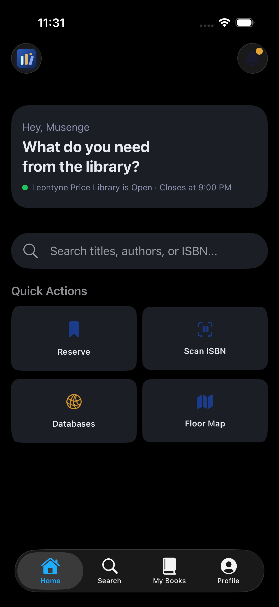
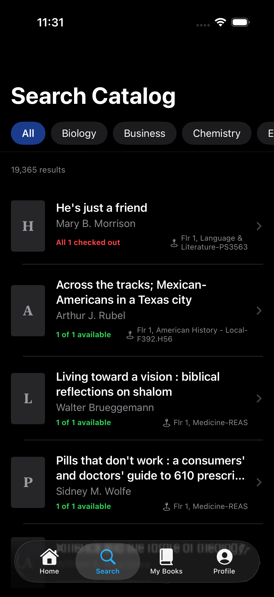
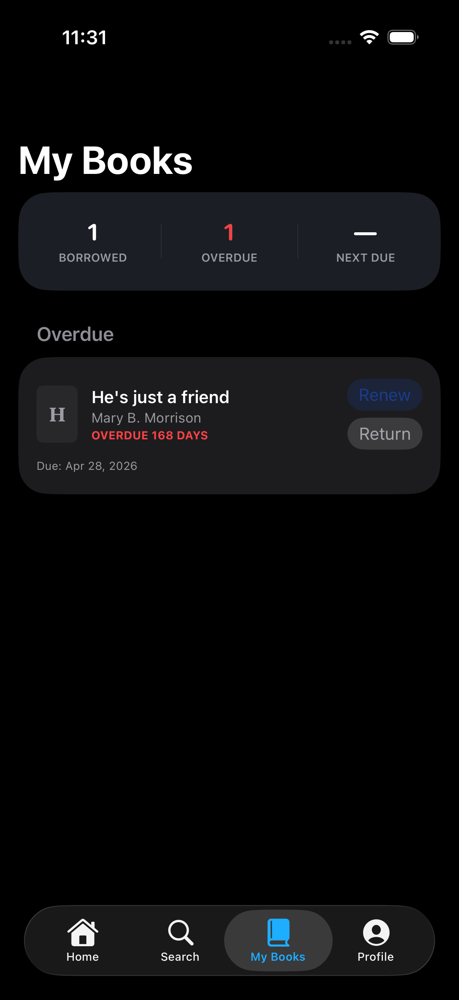

# MyBearcatLib

A native iOS app for Rust College's Leontyne Price Library: real-time book checkouts, due-date reminders, and an ISBN barcode scanner. A companion React dashboard lets librarians manage the ~19,800-book catalog.

Built as my senior capstone project at Rust College.

<!-- Screenshots: add images to docs/screenshots/ and uncomment.
<p align="center">
  
  
  
  
</p>
<p align="center">
  
</p>
-->

## Features

### iOS app (students)
- **Live catalog search.** Search the full catalog and filter by genre. Physical copies are grouped, so each title shows "X of Y available" in real time.
- **Checkouts and renewals.** 14-day loans with up to two renewals, tracked live in My Books.
- **Due-date reminders.** Local notifications 2 days before, 1 day before, on the due date, and when overdue. Each reminder has a **Renew** action.
- **Reservations and waitlist.** Reserve a checked-out book to join the queue. When it's returned, the next student gets a 48-hour hold and a notification.
- **ISBN barcode scanner.** Point the camera at a book's barcode to see availability, copy count, and shelf location.
- **Library resources.** Digital databases, a peer tutoring request form, and library announcements.
- **Campus accounts.** Sign-up is limited to `@rustcollege.edu` emails, with password reset. Includes dark mode.

### Librarian dashboard (web)
- Real-time view of every active checkout, with **Overdue**, **Due Soon**, and **Borrowers** tabs
- At-a-glance stats: active checkouts, overdue, due soon, and borrower count
- One-click **Check In** that marks the checkout returned and the book available in a single atomic write
- Search across checkouts and borrowers

## Tech stack

| | |
|---|---|
| **iOS** | Swift, SwiftUI, MVVM, AVFoundation (barcode scanning), UserNotifications |
| **Web** | React 19, TypeScript, Vite, Tailwind CSS v4, Lucide icons |
| **Backend** | Firebase Authentication and Cloud Firestore (real-time snapshot listeners) |
| **Data** | ~19,800 records imported from the library's LS2 PAC catalog; covers from Open Library |

## Architecture

```
Firestore ── books · checkouts · reservations · users
   ▲   ▲
   │   └── LibrarianDashboard (React)   check-in, monitoring
   └────── BearcatLib (SwiftUI)         search, checkout, renew, reserve
```

The iOS app follows MVVM, with views, a view model, and singleton services:

```
BearcatLib/
├── Models/        Book, Checkout, Reservation
├── Services/      Auth, Book, Checkout, Reservation, Notification (Firestore + UNUserNotificationCenter)
├── ViewModels/    AuthViewModel (auth flow + form validation)
├── Views/         Home, Search, My Books, Profile, Scanner, Book Detail, …
└── Utilities/     Theme (design system), AppSettings, Logo
LibrarianDashboard/
└── src/           components/, hooks/ (useAuth, useCheckouts), lib/firebase.ts
```

## Getting started

### iOS app
Requirements: Xcode 26+ and the iOS 26.2 SDK.

1. Clone the repo and open `BearcatLib.xcodeproj`.
2. Create a Firebase project with Authentication (Email/Password) and Firestore enabled.
3. Download that project's `GoogleService-Info.plist` and add it to the `BearcatLib/` target. It's gitignored, so it isn't included in the repo.
4. Build and run. The barcode scanner needs a physical iPhone, because the simulator has no camera.

### Librarian dashboard
```bash
cd LibrarianDashboard
npm install
npm run dev
```
To use your own Firebase project, put its web config in `src/lib/firebase.ts`.

## Author

**Joseph Musenge**, Computer Science, Rust College
